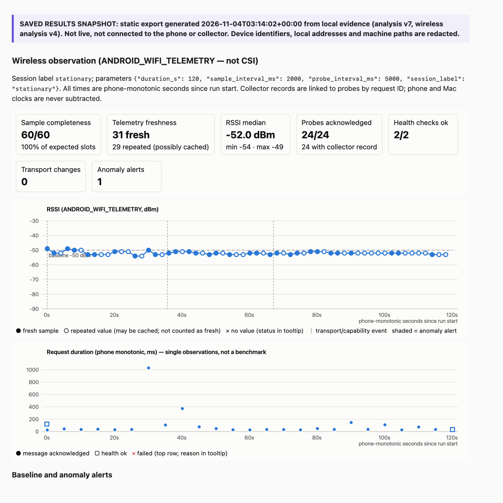

# AndroidNetGuard

AndroidNetGuard is a local prototype for collecting **evidence** about an Android phone's network
connectivity and reliability, with a Mac-side collector and dashboard.

> **Scope today:** connectivity and reliability checks, plus an opt-in **wireless observation
> session** that records Android Wi-Fi telemetry (`ANDROID_WIFI_TELEMETRY`: RSSI, frequency,
> link speed and capability changes; **not CSI**) with a transparent baseline detector. There are
> **no security-policy tests**, no VPN or isolation tests, no scores, no trained model, and no
> CSI hardware connected. These are listed as *Not implemented* in the dashboard and won't be
> claimed until they're real and independently verified.

## Components

```
 Android phone (debug app 0.4.1)                     Mac
 ┌──────────────────────────────┐   HTTP (test traffic)    ┌──────────────────────────────┐
 │ Connection · Tests · History │ ───────────────────────▶ │ collector/collector.py       │
 │ TestRunner (pure Java core)  │   LAN: 192.0.2.6:8765   │  binds specific IPs only     │
 │ Engine (Application scope)   │   USB: 127.0.0.1:8765     │  /health, /v1/test-message   │
 │ files/evidence/events.jsonl  │        (adb reverse)      │  evidence/server/<session>/  │
 └──────────────┬───────────────┘                          └──────────────────────────────┘
                │ adb exec-out run-as … cat (evidence channel, USB)
                ▼
         ┌──────────────────────────────────────────────┐
         │ dashboard/dashboard.py   127.0.0.1:8770 ONLY │
         │  import → evidence/device/<import>/          │
         │  analysis.py: correlate + classify (derived) │
         │  run pages, JSON + HTML exports              │
         └──────────────────────────────────────────────┘
```

* **Collector**: the only process that faces the LAN. It has health and message endpoints
  only and no control or dashboard routes. It validates input (4 KB body limit, strict
  fields, canonical UUIDv4 IDs), refuses wildcard binds, and appends JSONL with a server
  wall-clock time and a server monotonic time. Each start creates a new session directory.
* **Android app**: a plain Java `Activity` with no AndroidX or third-party runtime
  dependencies. Networking runs on a background executor with 5 s connect and 5 s read
  timeouts and bounded request and response sizes. The `Engine` lives in the `Application`,
  so screen rotation never interrupts a run. Every event is appended to app-private storage
  and synced to disk.
* **Dashboard**: stdlib HTTP bound to `127.0.0.1` only. It checks the Host header to
  guard against DNS rebinding, requires a CSRF token and same origin for import, and sends a
  strict CSP. It recomputes every status from raw evidence and never trusts the app's
  provisional verdict alone.

## Setup

```sh
cd AndroidNetGuard
cp env.example.sh env.sh
# Edit env.sh to set your JDK 17 and Android SDK paths before sourcing it.
source ./env.sh
./gradlew testDebugUnitTest assembleDebug
python3 -I -m unittest discover -s collector -v
python3 -I -m unittest discover -s dashboard -v
```

Toolchain: AGP 9.5.0, Gradle 9.6.1 (wrapper, checksum-pinned), JDK 17, compile/target SDK 36,
min SDK 26. Test device: REVVL `TMAF035G`, Android 13 (API 33).

Update the app in place. **Never uninstall**, because that deletes the app's evidence log:

```sh
S=DEVICE_SERIAL
adb -s $S install -r app/build/outputs/apk/debug/app-debug.apk
```

## Running

```sh
# 1. collector: bind the Mac's Wi-Fi address (check it first) and loopback (for USB mode)
ipconfig getifaddr en0
python3 -I collector/collector.py --host 192.0.2.6 --host 127.0.0.1 --port 8765

# 2. dashboard (second terminal, after `source ./env.sh`)
python3 -I dashboard/dashboard.py --port 8770 --serial $S
open http://127.0.0.1:8770/

# 3. USB mode only: map the phone's loopback port to the Mac over USB, then remove it afterwards
adb -s $S reverse tcp:8765 tcp:8765
adb -s $S reverse --remove tcp:8765
```

On the phone, enter the endpoints on **Connection**. USB mode uses `http://127.0.0.1:8765`;
Wi-Fi mode uses `http://192.0.2.6:8765`. Then pick a test on **Tests** and tap **Start**.
In the dashboard, click **Import from connected phone**.

Debug builds also accept an adb trigger (recorded as `trigger=adb_intent`):

```sh
adb -s $S shell am start -n com.androidnetguard.app/.MainActivity \
    --es ang.start_test wifi_sequence --ei ang.count 10 --ei ang.interval_ms 500
```

Test IDs: `usb_connectivity`, `wifi_connectivity`, `wifi_sequence`, `app_restart`, `wifi_reconnect`,
`wifi_observation` (extras `ang.duration_s`, `ang.sample_interval_ms`, `ang.probe_interval_ms`, `ang.label`).
Wireless sessions (live, machine-local only): `http://127.0.0.1:8770/wireless`. For a portable report, use the saved
snapshot in [`reports/public/INDEX.md`](reports/public/INDEX.md); see [docs/REPORTS.md](docs/REPORTS.md).

### The Wi-Fi address is pinned in the debug config

Cleartext HTTP is allowed **only in the debug build** and only to `127.0.0.1`, `localhost` and
`192.0.2.6`, in `app/src/debug/res/xml/network_security_config_debug.xml`. If the Mac's LAN
address changes, edit that entry and rebuild. Otherwise the app reports
`cleartext_not_permitted`, and the run becomes an `execution_error`.

## Measured validation (summary)

On one REVVL 6 Pro (Android 13), with every verdict derived from both app and collector evidence:
* USB delivery, direct Wi-Fi delivery, bounded sequences of up to 50 messages, app restart
  (both adb-driven and user-performed), rotation during a run, and Wi-Fi loss/return with
  recovery (on 0.4.1) are verified.
* Four wireless observation sessions recorded RSSI, link speed and capability changes. A signal
  drop to −75 dBm while the phone was moved and a 51 s Wi-Fi outage were both detected as alerts.
* Cancellation from the UI is verified on the device (stopped 4.5 ms after the tap, nothing started
  afterwards). Known gap: the app doesn't close the interrupted step's record; the analysis handles it.
* Full table: [docs/VALIDATION_SUMMARY.md](docs/VALIDATION_SUMMARY.md).

## Saved results

The current sanitized snapshot is listed in [`reports/public/INDEX.md`](reports/public/INDEX.md) (superseded ones are kept and marked) and opens directly in a browser, without
the collector or dashboard running.



## Documentation

* [docs/TESTS.md](docs/TESTS.md): each test's expected behaviour, required evidence,
  timeouts, and the conditions that make it inconclusive.
* [docs/EVIDENCE.md](docs/EVIDENCE.md): evidence layout, IDs, clocks, status rules and redaction.
* [docs/WIRELESS_OBSERVABILITY.md](docs/WIRELESS_OBSERVABILITY.md): Android Wi-Fi telemetry, permissions,
  value statuses, sampling limits, baseline thresholds and their rationale, failure attribution, demo.
* [docs/REPORTS.md](docs/REPORTS.md): start the live dashboard, regenerate sanitized saved reports
  (`python3 -I dashboard/snapshot.py` → `reports/public/`), and how screenshots are produced.
* [docs/CSI_HARDWARE_PLAN.md](docs/CSI_HARDWARE_PLAN.md): optional external CSI adapter (RuView ADR-018,
  pinned), candidate hardware to verify, and acceptance criteria. No hardware compatibility is claimed.
* [USB_SMOKE_TEST.md](USB_SMOKE_TEST.md), [WIFI_SMOKE_TEST.md](WIFI_SMOKE_TEST.md): the first
  verified connectivity observations.
* [VALIDATION.md](VALIDATION.md): what has actually been run on the real device, with results.

## Limitations

* Observed transport is Android's report for the default network and isn't independently verified.
* USB-mode traffic travels over adb reverse and says nothing about Wi-Fi.
* The phone and Mac clocks aren't synchronised. Durations come from each device's monotonic
  clock and are never computed across the two devices.
* Wait-step outcomes ("restart observed", "Wi-Fi loss/return observed") are app-side observations.
* Elapsed times are single observations, not benchmarks.
* The app evidence log is capped at 5 MB. When it's full, new runs become an `execution_error`.
* `evidence/` and `collector/data/` are git-ignored private originals. Share only the
  public (redacted) exports.
